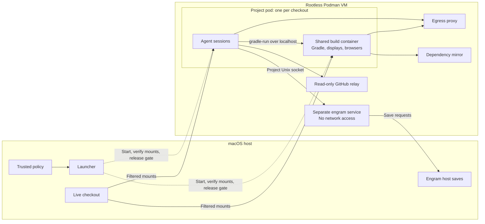

# Architecture and security model

Maintainer reference for agent-run. Installation and daily use belong in the
[README](../README.md). Supported policy settings belong in
[Configuration](configuration.md). Keep those documents consistent with behavior.

## Components and ownership

agent-run uses rootless Podman on macOS Apple Silicon with the krunkit-backed `libkrun`
provider. The host launcher reads trusted configuration and orchestrates containers.
Agents edit the user's live checkout. Changes appear directly on the host.

Arrows show selected data/control paths. The engram service uses a socket and request
storage to communicate with the host save process.

| Component | Responsibility |
|---|---|
| `policy` | Strict policy parsing, validated settings and project identity. |
| `workspace` | Checkout inspection, protected-folder discovery, IDE/Git/engram preconditions. |
| `mountplan` | Deterministic mount plan, identity/hash, Podman arguments and verification. |
| `gate` | Hold the command until verified mounts are released. Announce attachment readiness. |
| `podman` | Podman process execution, object namespace and shared-service lifecycle. |
| `pod` | Project identity, internal network, pod, volumes and stored plan. |
| `agents` | CLI-specific arguments, instructions and session MCP configuration. |
| `sessions` | Agent-container preparation and arguments, independent of CLI conventions. |
| `builds` / `buildrun` | Build-container state and the `gradle-run` request/queue/output protocol. |
| `vision` | Per-session display and browser in the build container. |
| `egress` / `approvals` | Proxy rules, denials, session grants and persistent approval edits. |
| `relay` / `mirror` | Restricted GitHub API access and dependency repository configuration. |
| `engram` | Separate context service, socket/mounts and requested host saves. |
| `agent` | Composition, progress, public commands and lifecycle ownership. |

Keep domain decisions in their owning modules. The launcher wires dependencies and
orders steps. It should not duplicate path classification, service policy or CLI logic.
Use explicit process/effect seams where failure tests need control.

## Trust model

**Untrusted:** agent CLIs, their subprocesses, build scripts, build containers, writable
homes/caches/outputs, and every file an agent can modify.

**Trusted:** the host launcher and installation, policy/state used for security decisions,
container images, and infrastructure configuration. Proxy, relay, mirror and engram
request handlers are exposed attack surfaces: their inputs must be validated.

Never interpret agent-writable data as trusted host commands or configuration. An
explicit host-side save workflow is a separate boundary whose arguments, paths, commit
scope and Git environment require validation.

The Podman VM and host are outside the containment model if already compromised.
Keep trusted installation/configuration/tooling outside writable workspaces.

## Workspace enforcement

- Bind-mount the canonical checkout at its host path. Policy specifies exact relative
  folder names, not glob rules.
- Read-only folders expose host contents without writes. Masks hide contents. Private
  mounts replace host folders with project-owned container storage, without copying host
  contents.
- Git metadata must be read-only independently of optional policy rules. Conflicting
  rules or physical/case aliases must not weaken that invariant.
- Protect existing supported real host-agent configuration folders and host Gradle state.
  Build scripts and ordinary source remain writable.
- Discover Gradle state/settings using case-insensitive names on the supported filesystem
  while preserving actual paths. Pin mount-target parents so renaming an ancestor cannot
  move protected content back into the writable view.
- Reject unsafe mount-argument characters and symlink traversal in ordinary protected
  targets. Compare canonical identities, not textual path prefixes.
- On case-insensitive host filesystems, single-file mounts can be bypassed through another
  spelling. Do not rely on them to protect secrets. `local.properties` is accepted only
  for supported SDK/NDK path entries.

Both agent and build containers start behind the gate. Verify the actual mounted
filesystem against the plan before releasing any command. Checks include type-specific
source identity, bind inodes, mount roots/options, private-volume subpaths, required
masks, and unexpected checkout submounts. Plan generation must include every required
protection.

Store plans outside the checkout and bind their hashes to pod labels. Reused pods retain
their original plan. Workspace-rule changes require restart. Newly appearing rule folders
can remain unprotected until then and must be reported.

Host-tool checks are part of this boundary:

- Refuse automatic IntelliJ Gradle reload that could execute live agent edits on the host.
- Refuse Git configuration/includes/hooks and detectable command references depending on
  writable checkout paths. Physical resolution must account for missing tails, symlinks,
  `..` and replaceable traversal components. Command analysis is best-effort.
- Validate required engram-owned links/targets and host-established immutable flags.
  agent-run does not install or activate engram or replace host project configuration.

## Containers and build state

Each checkout has one internal network and project pod with a shared `keep-id` user
namespace. Sessions share its build container and localhost. Different checkouts use
separate project identities and volumes.

Agent/build containers use read-only roots, dropped capabilities, no-new-privileges,
PID limits and policy CPU/memory caps. Defaults are 2 CPUs/2 GiB per agent and
8 CPUs/16 GiB per project build container. The VM's
allocation limits aggregate resources.

`gradle-run` runs inside an agent container and sends cwd, arguments and supported
session metadata to the build server. The server validates the checkout/wrapper root,
queues work per project, streams output and returns status. General environment
forwarding and interactive build stdin are not requirements.

Redirect build outputs, project caches and Kotlin state into container-owned storage.
Keep safety-net submounts for writes occurring before redirection. Gradle home and Android
SDK use separate project volumes. Agents read build results. Builds write them. Host
Gradle state must remain untouched.

Cancellation must remain observable during continuous output, installer-lock contention,
downloads and extraction. Own request processes/descendants, reap them and release queue
capacity within bounded time. Do not terminate unrelated shared daemon work.

Images provide tools and JDKs. Mirror wrapper
installations check published/configured checksums before marking completion. Refresh
host SDK licenses without modifying host files, including retries after failed copies.

Displays/browser servers are allocated per session but live in the shared build container.
Every session in the pod can access them.

## Egress and services

Project networks are internal. The proxy is the controlled outbound route. Ordinary
allowlisted access uses HTTPS CONNECT. Explicit local-service exceptions deliberately
permit named host/port HTTP access.

- Shared grants are available to builds and agents. Authenticated session grants combine
  identity and project subnet. One agent type's direct grants do not automatically become
  another agent type's grants.
- Agents in a project control build code and share localhost/state. Access available
  through shared services remains shared.
- Refuse unapproved names before address resolution, block private/host destinations
  except explicit narrow exceptions, restrict ports/methods and deny by default.
- The GitHub relay fixes its upstream, restricts repository paths/methods and does not
  forward host credentials.
- The dependency mirror serves configured remotes. Build repository mappings are captured
  when the build container starts. Changed mappings require project restart.

Authorization reconciliation must reload current trusted policy under the appropriate lock. Desired configuration and successfully applied state
are distinct. Failed application must remain retryable through the public command even
when desired persistent state already reflects the request.

Image replacement must preserve data and every required project-network attachment,
address and alias. Record restoration intent before destructive changes and retain it
until retries succeed. Handle stale active project-container images explicitly.

Revocation applies to fresh connections after successful application. Existing tunnels
can survive until closed. Permitted destinations can receive anything an agent can read.

## Engram host-save boundary

The host prepares engram and declares its existing project package in policy. The context
service is outside the project pod, with its own network namespace and no network access.
It mounts engram data. Agents reach it through a project-specific
Unix socket and receive narrow read-only instruction/skill mounts, including linked targets.

Agents request context saves through engram tools. The host save workflow commits context
using host signing configuration. Workspace Git metadata stays read-only. Validate
external request paths and commit scope, use separate argv values rather than generated
shell commands, serialize project saves and retain failed requests for retry.

Verify request paths, commit scope and Git/signing behavior in the external engram
server/save implementation. Join save workers and wait for signing outside the global
startup lock. Save summaries are printed when the session ends.

## Lifecycle invariants

- Own resources from first acquisition, including pre-pod networks/helpers, through
  attachment and cleanup. Roll back partial failures without deleting reused/shared
  resources or intentionally persistent volumes.
- Serialize allocation and short destructive teardown. Keep stopped session reservations
  until output/status collection and cleanup finish.
- Use acquisition/generation identity, not reusable names alone, when old cleanup may run
  after forced shutdown or replacement. Previous owners must not delete new resources.
- Handle signals during startup, lock waits, subprocess/input waits, attachment and exit
  collection. Noncancellable operations belong only in bounded cleanup where necessary.
- Establish actual attachment readiness before command release. Separate readiness control
  from output. Afterward preserve command bytes verbatim, including control sequences.
- Preserve primary command status/errors while reporting cleanup failures separately.
- Project restart ends its sessions. Infrastructure shutdown protects active sessions unless
  explicitly forced, remains namespace-scoped and preserves persistent data.

## Accepted limitations

- Live source, build scripts and tracked agent instructions can be edited. Users must
  review them, including ignored/new files, before running host tools.
- Newly appearing protected folders need pod restart. Single-file aliases and pre-existing
  hard links can expose content outside the intended folder mount view.
- Nested repositories can contain command-bearing Git configuration. Host tools must not
  automatically operate on agent-created repository roots.
- Sessions of one checkout share build state, localhost, displays and service exposure.
- Allowed destinations can receive sensitive data. Revocation does not close established
  tunnels.
- Trusted installation/state must remain outside writable workspaces. Host/VM compromise
  and manually executing edited code are outside containment.

## Verification requirements

Run enabled tests, Clippy and formatting checks as documented in [AGENTS.md](../AGENTS.md).
Verify filesystem, namespace and Squid enforcement in integration tests.

- Test deterministic policy, classification, argv and mount-report decisions locally.
  Assert structured values, not joined command strings.
- Cover aliases, traversal, malformed input, partial acquisition, failed application/retry,
  blocked signing, signals, output-byte boundaries, cancellation under load and generation
  replacement. Prove new regression tests fail when the defect is reintroduced.
- Exercise public wrapper/CLI seams as well as library composition. Use self-contained
  fixtures, isolated Git child environments, bounded readiness/exit waits and explicit
  cleanup. Never run planted host payloads to demonstrate a guard failure.
- Use disposable rootless Podman namespaces/checkouts and scratch `AGENT_RUN_HOME` for
  integration tests. Check real mount aliases, fresh versus established connections,
  multi-project service recovery, resource quotas and actual cancellation.
- Use controlled listeners to prove filtering, authenticated ready tunnels to test
  revocation, and frozen external engram fixtures rather than personal defaults.
- Preserve existing credentials/settings/user MCP entries and verify effective session
  overrides without modifying host files.
- Record the tested environment, results, unrun boundaries and end-to-end startup timings.
